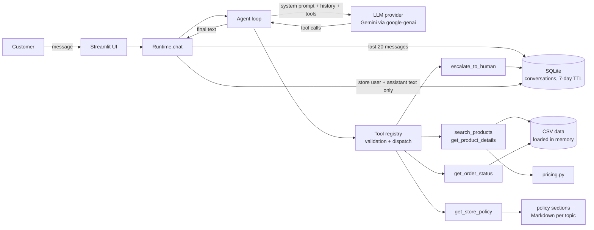

# Architecture

## Overview

## Request flow

1. The UI keeps the session id in the URL, so a returning customer resumes the same conversation.
2. `Runtime.chat` loads the last 20 user/assistant messages of the session (expired sessions are purged first).
3. `Agent.respond_stream` builds the system prompt (persona, rules, reference date, current time and whether this is the first message) and starts a turn with the provider, sending the tool declarations.
4. While the model asks for tools, the registry validates arguments and runs them. Errors are returned to the model as data (`{"erro": ...}`), never as exceptions. A turn is capped at 6 tool rounds.
5. Text is streamed to the UI as the model generates it. Until a data tool has run in the turn, text is held back for the **grounding guard**: a reply that quotes a price or promises to check something without a tool call is rejected and the model is corrected (D23, D24).
6. Only the user message and the final reply (exactly the text shown) are persisted; tool results are discarded.

## Modules

| Module | Responsibility |
|---|---|
| `config.py` | Settings from environment / `.env` (provider, model, reference date, TTL, paths). |
| `data/loader.py` | Loads the CSVs into typed records; flags unreliable descriptions and order totals that don't match (see `DATA_AUDIT.md`). |
| `pricing.py` | Promotion, PIX and installment rules with `Decimal`. The LLM never does price math. |
| `policies/` | Policy manual split into one Markdown file per topic + `PolicyTopic` enum. |
| `tools/catalog.py` | Product search with filters and product details with alternatives. |
| `tools/orders.py` | Order lookup with identity verification, delay detection, return windows and anti-enumeration lock. |
| `tools/policies.py` | Policy lookup by topic. |
| `tools/handoff.py` | Registers cases for the human team and returns a protocol number. |
| `tools/registry.py` | JSON Schema declarations (provider-agnostic) and defensive dispatch. |
| `llm/base.py` | Provider interface (`LLMProvider`, `ChatTurn`, messages, tool calls). |
| `llm/gemini.py` | Gemini implementation with the official `google-genai` SDK. |
| `agent.py` | The function-calling loop and system prompt rendering. |
| `memory.py` | SQLite conversation store with TTL. |
| `runtime.py` | Wires everything together. |
| `app/streamlit_app.py` | Chat UI. |
| `scripts/` | Scenario runner (examples) and red-team script. |

## Why each tool exists

| Tool | Question types | Notes |
|---|---|---|
| `search_products` | "Quais violões até R$1000?", "tem ukulele tenor?" | Filters by final price (promotion applied); hides unavailable items unless asked; reports empty categories. |
| `get_product_details` | "Quanto custa o Takamine GD20?" | Fuzzy name match; ambiguity returns candidates; unavailable items return alternatives. |
| `get_order_status` | "Cadê meu pedido?", "posso devolver?" | Needs order number + e-mail/phone of that order's customer. |
| `get_store_policy` | Hours, address, payment, returns, shipping, promotions, warranty, privacy | One manual section per call (token cost proportional to the question). |
| `escalate_to_human` | Complaints, delays, disputes | Manual §7.3: register and reply within 24 business hours. |
