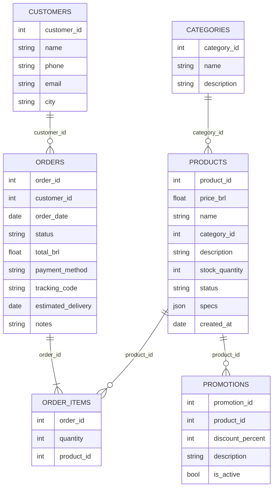

# Data Audit

Audit of the material provided by the store (`data/raw/*.csv` and `data/raw/políticas_da_loja.pdf`),
done before any code was written (decision D07). Each finding lists how the agent handles it.

## 1. How the tables connect

- `order_items` is the N:N bridge between orders and products (it has no unit price — the price
  paid has to be inferred from the current catalog price).
- `promotions` hangs off products; a product can have several promotion rows over time, at most
  one active.
- Referential integrity is fine: every foreign key resolves.

| Table | Rows | Notes |
|---|---|---|
| categories | 9 | 3 categories have no products |
| products | 65 | `specs` is JSON whose schema varies by category |
| orders | 20 | 2025-10-15 → 2026-03-22 |
| order_items | 22 | |
| customers | 50 | only 18 have orders |
| promotions | 25 | only 4 active |

## 2. Findings in the CSV data

| # | Finding | Evidence | How the agent handles it |
|---|---|---|---|
| F01 | **Name/description mismatch** in products 135–144 | e.g. 135 "Music Man Bass 1X" is described as a Fender Jazz Bass; 137 "Yamaha Bass 3X" says "5 cordas Ibanez" but `specs.strings = 4`; 139 "Bateria Yamaha Kit 1" describes a Pearl Export; 142 "Korg Synth 1" mentions 88 keys of a Roland while `specs.keys = 61` | **Name + specs are the source of truth.** Descriptions of these products are flagged and not sent to the LLM. |
| F02 | **Empty categories** | 6 (woodwinds), 7 (brass) and 8 (orchestral strings) have no products, although the manual lists them | Agent says the instrument is not available at the moment instead of inventing products. |
| F03 | **Catalog much smaller than the manual claims** | Manual: "mais de 300 instrumentos"; CSV: 65 | The CSV is the system of record; the agent never claims items that are not in it. |
| F04 | **Discontinued / coming-soon products** | 113 and 136 are `discontinued` (136 still shows stock 13); 130 is `coming_soon` (stock 2) | Not offered for sale. Agent explains the status and suggests similar active products (manual §7.3). |
| F05 | **Active product with zero stock** | 96 Giannini GF-3D | Reported as temporarily unavailable; alternatives suggested (manual §7.3). |
| F06 | **Order totals that don't add up** | Order 3: 2 × R$1,749 = R$3,498 vs total R$3,450. Order 20: R$799 + R$689 = R$1,488 vs total R$1,400 | Agent shows the **recorded** total; tool returns an internal warning and the agent escalates to the team if the customer questions the amount. |
| F07 | **PIX discount never applied in order totals** | Orders 1, 5, 10, 13 (PIX) equal the full list price | Could be a data artifact. Agent does not speculate about past totals; PIX discount is applied only to current quotes. |
| F08 | **Coming-soon product inside orders** | Product 130 appears in delivered order 3 and pending order 14 | Order lookup still works; the product's current status does not change past orders. |
| F09 | **Cancellation reason no longer true** | Order 18 cancelled for "out of stock", product 85 now has 10 units | Agent reports the historical reason and can say the product is available again. |
| F10 | **Delayed shipment** | Order 8 is `shipped` with estimated delivery 2026-02-28; reference date is 2026-03-25 | Tool computes `is_delayed`; agent treats it as a complaint (empathy, register, 24 business-hour return — manual §7.3) via `escalate_to_human`. |
| F11 | **Duplicate / historical promotions** | Products 93, 96 and 99 have several inactive rows; 96 has an inactive 40% promotion | Only `is_active = 1` rows count. Agent never promises expired discounts (manual §7.3). |
| F12 | **Only 4 active promotions** | Products 90 (18%), 94 (8%), 121 (20%), 127 (10%) | Promotion price shown with original price and % (manual §6.2). |
| F13 | **Shared e-mail between customers** | Customers 11 and 43 share `bruno.martins@jmail.com` | Identity check is done against the customer **of that specific order**, never by e-mail alone (D10). |
| F14 | **Similar customer names** | 11 "Bruno Carvalho Martins", 27 "Bruno Carvalho", 43 "Bruno Martins" | Names are never used for identification. |
| F15 | **No real delivery date** | Only `estimated_delivery` exists | Assumption: for delivered orders, receipt date = `estimated_delivery` (used for the 7-day regret window and 90-day legal warranty). |
| F16 | **No sales channel field** | Regret right (§4.1) applies to online purchases only | Assumption: all orders in the system are online purchases. |
| F17 | **Heterogeneous `specs`** | Acoustic guitars: top/back/strings/scale/electronics; electric: body/neck/strings; drums: shells/pieces; keys: keys/type/polyphony | Parsed into a dict; tools expose only the keys present. |
| F18 | **IDs out of order** | Product 145 appears between 130 and 131 | Irrelevant for the agent; IDs are used as keys only. |
| F19 | **Stale data vs. real date** | All orders are from Oct/2025–Mar/2026; orders 9–16 would be pending for ~8 months in Nov/2026 | `REFERENCE_DATE = 2026-03-25` (D11). |

## 3. Findings in the policy manual

| # | Finding | How the agent handles it |
|---|---|---|
| P01 | **Two phone numbers**: (67) 3341-4444 (cover, §1.2) vs (67) 3321-4500 (§7, WhatsApp) | They can both be valid (landline vs. WhatsApp). The agent gives (67) 3341-4444 as the store phone and (67) 3321-4500 as the WhatsApp channel, exactly as each section states. |
| P02 | **E-mail with and without accent**: `contato@emporiodamusica.com.br` (cover) vs `contato@empóriodamusica.com.br` (§1.2) | Accented domains are unusual and error-prone → the agent uses the unaccented version. |
| P03 | **Installment minimum contradiction**: table in §3 says "minimum installment R$100" for credit card; §3.1 scales by tier (≤3x: no minimum except below R$50; 4–6x: R$80; 7–12x: R$100) | The more specific rule (§3.1) wins. For ≤3x, "no minimum, except below R$50" is read as: each installment must be at least R$50. |
| P04 | **Regret counted from receipt, defect exchange from purchase, legal warranty from receipt** | Implemented exactly as written, each window with its own anchor date. |
| P05 | **Promotional calendar vs. data**: manual says Black Friday happens in November, data has no active Black Friday promotion | The data is the system of record; the manual itself says to check whether a promotion is active (§7.3). |
| P06 | **No holiday calendar** | Agent states the standard hours and that holidays are closed, without guessing specific dates. |
| P07 | **Freight to other cities depends on ZIP code, weight and size** | Agent informs carriers and delivery estimates; the exact value is calculated at checkout or by the team. |
| P08 | **Section 7 describes the attendant's behavior** | Turned into system prompt instructions, not a retrieval topic (D03). |
